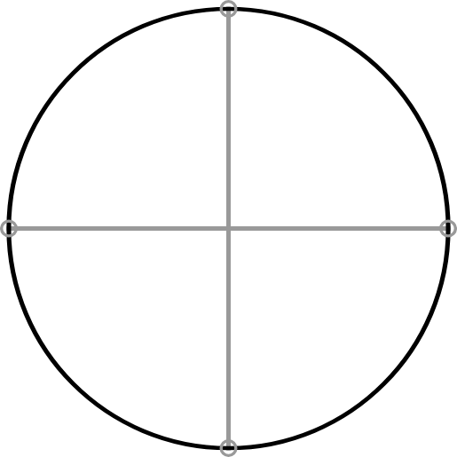
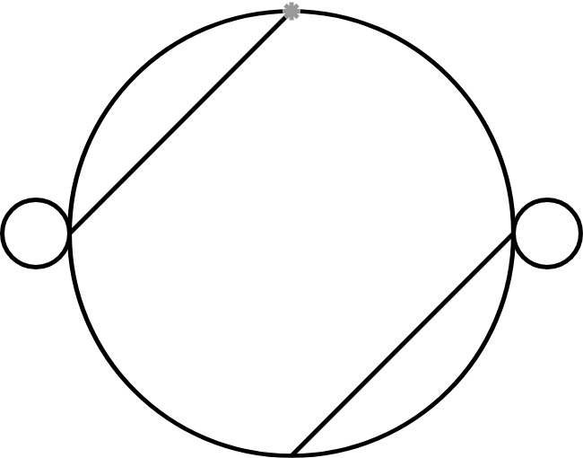
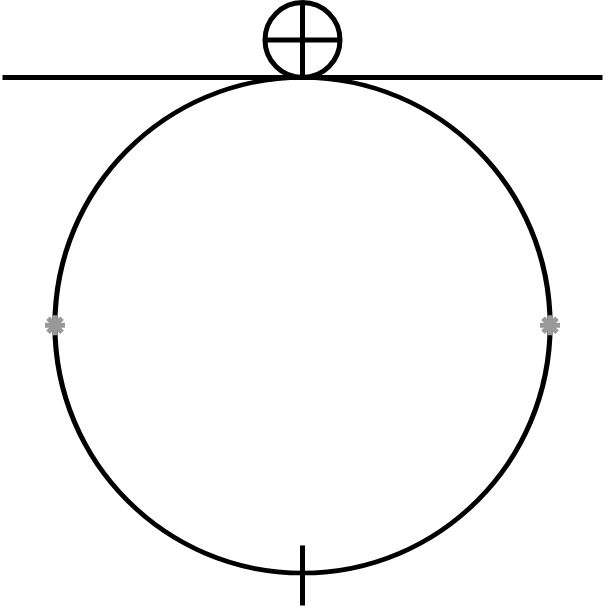
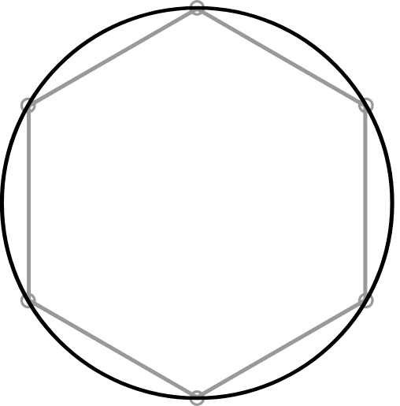
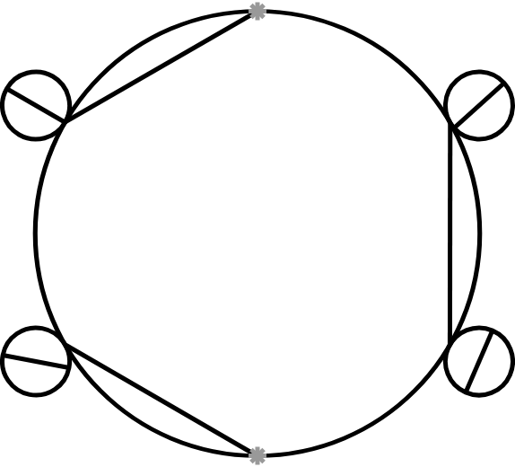
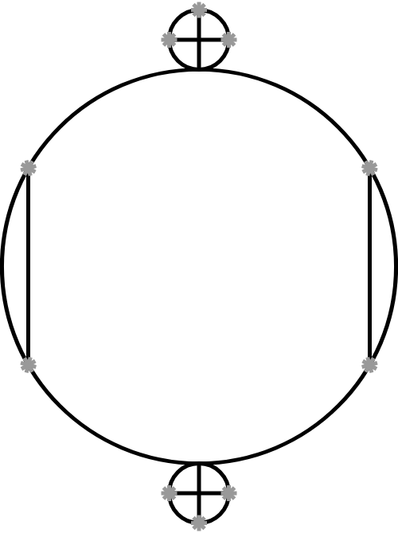
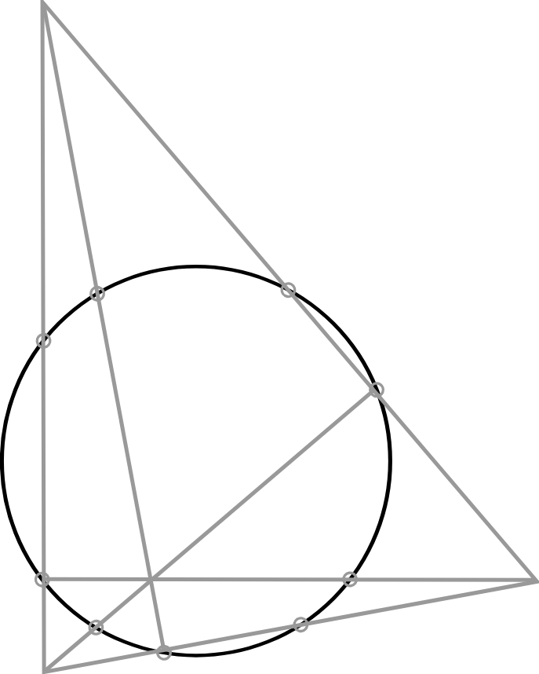
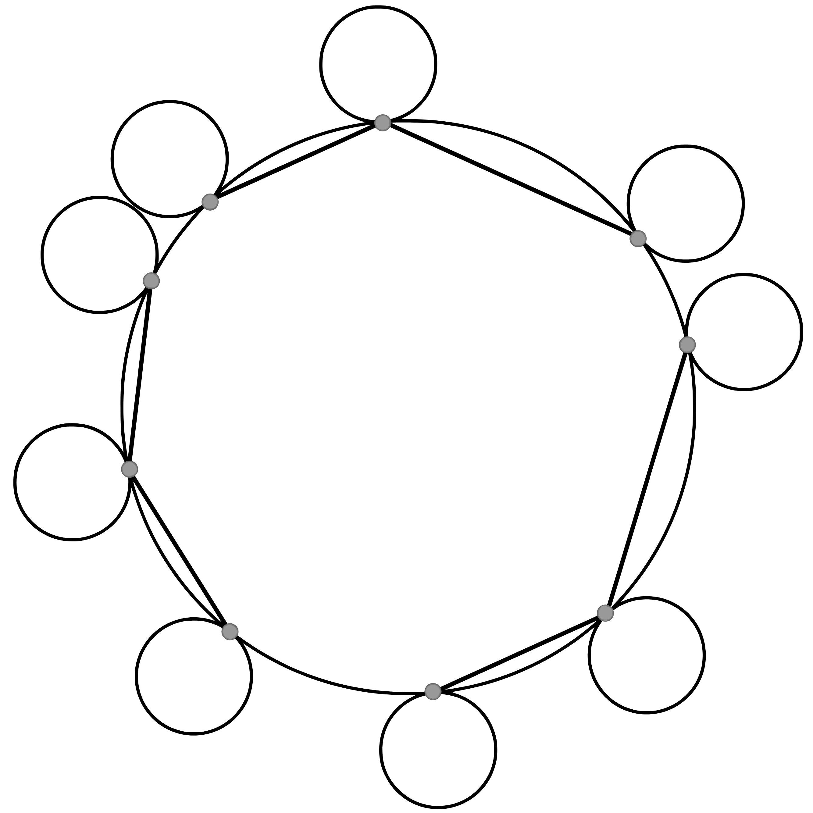
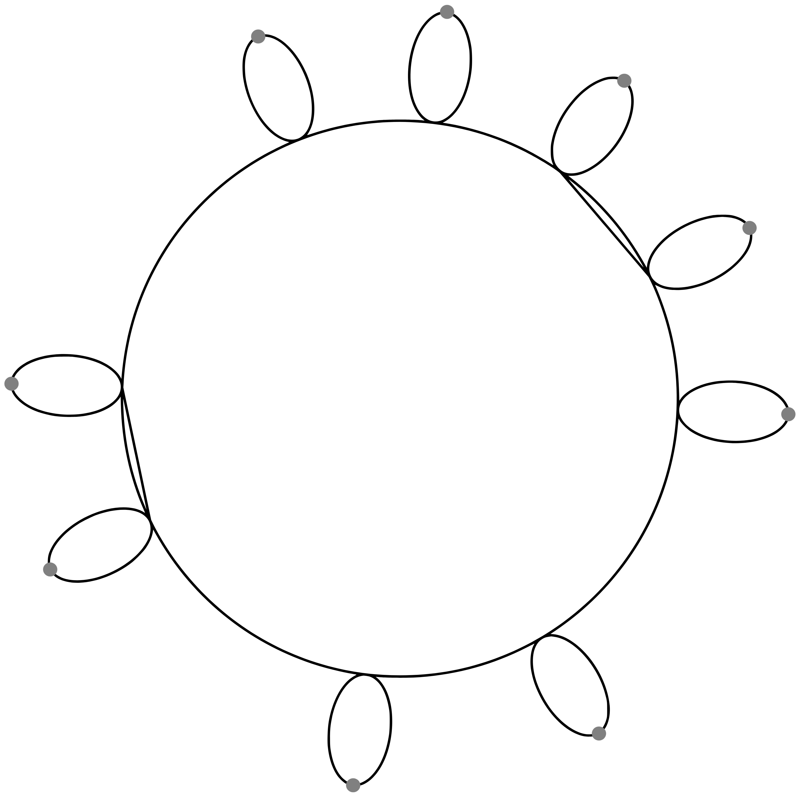
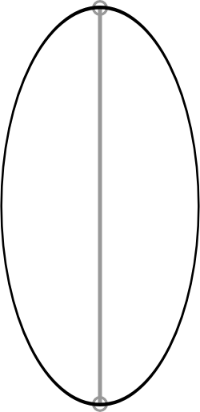

# Rithmatic Duels: Design Document

A two-player, simultaneous-choice strategy duel game, loosely in the spirit of Pokémon-style duels, built on the chalk-drawing magic system from *The Rithmatist*. Every action takes time to complete, and both players commit to actions each turn without knowing what the other has chosen.

This document is the single source of truth for the game's design. It began as a consolidation of earlier Notion notes; as of 2026-10-23 Notion is no longer maintained and is not kept in sync.

**Scope notes**
- All numbers are placeholders to be tuned through balancing.
- Only gameplay-relevant material belongs here. Story and lore from the novel are out of scope.
- Only four lines exist in the game (Warding, Forbiddance, Vigor, Making). The novel's Line of Silencing and Line of Revocation have no duelling relevance and are excluded.

---

## 1. Core concept

- Two players duel by drawing chalk lines. Lines either defend, attack, or create autonomous units (chalklings).
- Every drawing takes a number of **turns** to complete. There is a single unit of time (the tick, equal to one turn); different actions simply cost different numbers of turns.
- A player can only have **one drawing in progress** at a time, so what to commit time to is the central decision.
- **Win condition:** a player loses if their *main Line of Warding* is breached.
- **Turn limit:** default 60 turns, configurable per duel from 30 to 120 before it starts. Every turn counts, starting with the pre-game setup turn as turn 1, so the turn number shown is the count ("Turn N of 60"; changed 2026-10-25, it previously started once both main LoW were complete).
- **End of the duel:** if nobody has breached the other's main LoW by the turn limit, a tiebreak decides it (section 2.1). Only an exact tie is a draw.
- **Double breach:** if both main LoW are breached in the same tick, the breach that happens earlier within the tick (by time of impact along the moving line's path) wins. Only breaches at exactly the same moment are a draw.
- Stalling needs no special rule: with a turn limit and a tiebreak, mutual stalling benefits nobody, so at least one player is making a mistake by doing it.

### 1.1 The board

**Presentation principle (2026-10-25):** as far as possible, rules are shown with visuals or enforced by the interface (snapping, greyed-out options, outlines that cannot go somewhere illegal) rather than explained in text.

**Invalid choices can't be selected (universal, 2026-10-27):** anything the rules wouldn't allow can never be picked, rather than being picked and then refused at Lock in. Every disallowed option or location shows a visual sign that it isn't valid: buttons are greyed out, bind points that can't be used are filled in red, a spot on the board where nothing can be placed shows a red cross under the mouse and ignores clicks, and a size or length can only be scrolled through values that fit. This applies to every new feature.

**Accessibility throughout (universal, Amelia, 2026-10-27):** accessibility is considered in every feature that changes how the game looks, sounds or is controlled. Known friction points and planned fixes, such as configurable colours for colour blindness, are listed in `docs/ACCESSIBILITY.md`, and new ones are added as they are found.

**Consistency everywhere (universal, 2026-10-27):** the same kind of thing always works and looks the same across the whole game. This covers controls, menus, visual signs, wording and rules, not one feature at a time. Controls are one example: scroll changes a drawing's size (a circle's radius, a LoF's length, an ellipse's overall size), Shift + scroll its shape or turn (an ellipse's roundness, which of a nine-point circle's bind points joins), and right-click goes back one step. Others: one colour or sign means one thing everywhere, and the same structure follows the same rules wherever it appears (a Mark's Cross is only its parts). Anything new must follow the patterns already in use. When a feature doesn't fit them, or an existing part of the game already breaks one, the proposal should say so unprompted and suggest the consistent option, instead of quietly adding a one-off.

**One colour, one meaning (universal, Amelia, 2026-10-27):** a colour is never reused for a different function. This is not a blanket ban (Amelia, 2026-10-27): things with a similar property may share a colour, for example red for everything that can't be picked, or blue for every aim line. What a colour may not do is mean two unrelated things. Before giving anything a colour, check every colour already in use (board marks, previews, highlights, hover marks, menus) and pick one that means nothing else. When a clash is fixed by moving one of them, its new colour must not clash with something else either, and a mark that already has a colour shared by its other forms (for example the blue aim line) keeps it. Colours live in one place so this can be checked, and so they can be made configurable (`docs/ACCESSIBILITY.md`).

The board is **continuous 2D**, with snapping to help placement.

- Lines are real shapes: a LoW is a circle (centre and radius) or an ellipse, a LoF is a straight segment, a LoV travels along a direction vector.
- **Snapping (default mode):** a player's selections snap to bind points and to cardinal directions where applicable. For example, a LoF drawn on the circumference of a LoW snaps to being a tangent.
- **LoV aim is free:** a LoV can be angled in any direction, never snapped. While placing it, its aim line shows where it would go: it reflects off LoF (and the centre LoF while it stands) by the same rules as in flight, and stops at the first LoW, chalkling or board edge. It ignores other LoV and anything that moves (2026-10-27).
- **Own half only (tightened 2026-10-25):** nothing a player draws may be on, or reach into, the opponent's half once it is complete: a LoV's starting point, every part of a LoF (free or tangent), the whole outline of any LoW or Mark's Cross, and an unbound chalkling. The scroll wheel can't make a LoF or LoW bigger than fits. Only lines that move afterwards (LoV, chalklings) can cross over. This stops point-blank attacks on the opponent's defence.
- **Centre LoF (decided 2026-10-25):** for the first 10 turns (a placeholder, counting the setup turn as turn 1) a LoF stands along the line between the two halves, so neither player can play too aggressively early on. It belongs to neither player, can't be damaged and reflects LoV like any LoF; it blocks chalklings too, which wait at it until it goes (section 4.4). It is removed in stage 1 of the tick on turn 10 (with dismissals, section 3; decided 2026-10-29), so it no longer blocks anything that moves that tick. It can be switched off (`CentreWallConfig`), and may become a duel option later.
- **Free hand mode (changed 2026-10-29):** hold Ctrl (Cmd on macOS) to stop a LoF or chalkling with no mode or tether chosen from snapping to bind points, in the preview under the mouse as well as on click (2026-10-29). It has no effect where a bind point is required. Lines that are straight (such as LoF) are still drawn straight.
- **Placement order (decided 2026-10-29):** a placement can be picked as soon as the line type is chosen, before or after its other settings. Hovering the arena shows a preview of a placement at the mouse. A setting that wouldn't fit the placement already picked is greyed out. Right-click order stays fixed, with the placement always undone first.
  - **LoW:** the bind point can be picked before the number of bind points. Until a count is chosen no shape shows, only the bind point highlight. A bind point is red if it is full or if no kind of LoW fits there.
  - **LoF with no mode chosen:** a click near a bind point (within 0.75, placeholder) selects it, but no line shows yet. Clicking the same bind point again makes a tangent there; clicking another bind point joins the two. Bind points that can do neither are red. A click elsewhere starts a free LoF. The mode button lights up once the line is decided. Choosing a mode first works as before.
  - **LoV:** can be placed before its frequency tier is chosen.
  - **LoM:** placement ignores the modifier and stats (stats count as 0 until set). With no tether chosen, a click near a bind point binds the chalkling (its glyph becomes Defend), unless Attack is already chosen. With no glyph, the preview is a plain circle with no ring or path. Previews hide over invalid spots.
  - **Colour (accepted 2026-10-29; the exact shade is left for polishing):** a placement preview that only follows the mouse is a darker blue (about #4D8CF2) than a picked, not-yet-locked placement (light blue). Aim lines and attack paths always stay light blue.
- Collision is computed geometrically (segment, circle and ellipse intersection), so reflections off LoF use the true angle.
- **Main LoW placement (changed 2026-10-25):** each player's main LoW goes at the same fixed spot, the back preset: centred 6 units from their own short edge (section 2). Free placement is kept behind a switch (`GeometryConfig.MainWardAtHome`) but is off.
- **Scale (placeholder):** the board is 32 x 20 units. The default main LoW radius is 3 units. Its default spot, used when nothing chooses one (tests, and the timeout default), is centred 6 units from the player's own short edge.

## 2. Turn structure

Each turn:

1. **Frozen time.** Time is paused while both players choose.
2. Each player is given a menu of available actions and chooses one **without knowing the other's choice**.
3. Choices are locked, time resumes for one tick, and the tick resolves (section 3).
4. The next turn begins.

**Decision timer.** Each turn has a time limit for choosing, configured by the players before the duel starts: default 30 seconds, settable from 10 to 120 seconds, or off (for hotseat and practice against the AI; online duels require a value). On timeout, the player's action is **Continue drawing** if a drawing is in progress, otherwise **Pass the turn**.

**Pre-game setup (decided 2026-10-25).** Each player secretly sets up their main LoW before anything else; no other line and no passing is available. They choose, on one screen:

1. **Shape:** a circle, or an ellipse. The ellipse's flatness is variable (adjusted with the mouse scroll wheel, with or without Shift; decided 2026-10-27); flatter ellipses are weaker along their sides (section 4.1).
2. **Position:** fixed, at the back preset spot (centred, 6 units from the player's own edge; decided 2026-10-25). Choosing a position was removed because a main LoW built against the centre line let players draw into the opponent's half.
3. **Bind points:** 4, 6 or 9 for a circle. An ellipse always has 2, at the ends of its long axis. (More flexible bind point counts and positions are planned.)

The main LoW can't be rushed or steadied. When both players have locked in:

- **Both outlines are drawn immediately**, with no modifier. This is the start of the duel: the outline is a real LoW that can be hit and breached. The setup turn is turn 1.
- **Each player's bind points start drawing** straight away. This is the time-consuming step: (bind points) div 2 turns, the setup turn counting as the first. Bind points can't be rushed or steadied and roll no modifier (a modifier for bind points may be considered later).
- **Nothing else can be drawn until the bind points are complete.** Meanwhile a player can Continue, Cancel or Pass.
- **Cancelling the bind points** leaves the outline in place and scraps the bind points. The player can start new bind points immediately (in the same turn, possibly a different count) or pass and start them on a later turn.

Players can pick a saved defence preset (section 6.8) so they do not have to select each line every duel. Players can pick a saved defence preset (section 6.8) so they do not have to select each line every duel.

### 2.1 End game: chalk fatigue and tiebreak

The end game is pressured in two ways, similar to tiebreaks and overtime pressure in games like Clash Royale.

- **Chalk fatigue:** during the last 15 turns of the duel, every main LoW loses 1 durability every 3 turns.
- **Tiebreak:** if the turn limit is reached with no breach, the player whose main LoW has the higher share of its maximum durability left wins. An exact tie is a draw.

### Information

- Players can **see what the opponent is drawing in progress**, but not its exact specifications.
- **On the board (decided 2026-10-25):** a drawing in progress is shown where it will go, faint and dashed in its owner's colour, for both players. It is only a picture and has no effect on the game until it is complete. Its place and shape show (a LoF's length, a LoW's size and bind points, a LoV's start and direction, where a chalkling will stand); its pace, progress, chalkling stats, glyph and modifier stay hidden. It appears once the turn it was started in resolves. Looks: LoF a dashed bar; LoW a dashed outline with unfinished bind points (and dashed braces for a Mark's Cross); LoV a dotted wave at its start, pointing the way it will go; LoM a hollow circle, with a dashed tether if bound; bind points under way on the main LoW unfinished bind points. An unfinished bind point is a faint dashed ring with no centre dot; a finished one is a solid ring with a dot (decided 2026-10-27). Dismissing a LoF takes 1 turn and finishes in the tick it is started, so it is never seen in progress.
- **Lines list (decided 2026-10-27):** at any point in the duel (handover, choosing, results), Tab shows the names of every active line of both players (LoW, LoF, LoV and LoM), with what each player is drawing, on a translucent panel over the menu; Tab, Esc or a right-click closes it (decided 2026-10-29) (while the player is typing in a LoM stat box, Tab and Shift+Tab move between the boxes instead; Enter moves to the next box and leaves keyboard entry from the last one, Esc or clicking the board leaves the box; one press of Tab toggles the list once, however long it is held; decided 2026-10-29). The menu shows through but can't be clicked or highlighted, and the list scrolls if long, like the log. Hovering an entry highlights that line on the board with a glow matching its owner's chalk (grey for player A, golden-yellow for player B; decided 2026-10-27), and hovering a line (or its entry) gives the entry the light grey background of a hovered menu button and lights the line up on the board; a hovered LoV also shows its aim line. The mouse pointer is the normal one while the list is open (not the blue of placement previews) and shows the same stats box as hovering the line itself (on the board, while Alt is held); hovering a target in the Dismiss LoF menu highlights it the same way. All highlights reach the same distance past their line's edge, and wrap fully round the ends of a LoF or LoV (decided 2026-10-29). Using the - and + buttons or scrolling over a stat box never puts the box into typing mode.
- **Line info key (decided 2026-10-29):** hovering a line on the board shows its stats box (and its aim line or chalkling preview) only while Alt (Option on macOS) is held, and holding Alt also gives the hovered line the same glow as the lines list. The key is defined in one place so it can be made rebindable (`docs/FUTURE_IDEAS.md`, Settings).
- They must infer as much as they can from what is visible on the ground and from knowledge of the lines and tactics.
- Defence choice is not announced. A player learns the opponent's defensive strategy only from what has been drawn.

## 3. Tick resolution order

While players choose, time is frozen. LoV that have been drawn and are not yet destroyed will each move a distance determined by their speed during the tick. When time resumes, the following happen in order:

Once both players have locked in their choices (decided 2026-10-25):

1. **Dismissal.** Any LoF being dismissed this tick disappears instantly. On the last turn of the centre LoF (turn 10), it is removed here too (decided 2026-10-29).
2. **Rushed lines are finished.** Any rushed drawing that finishes this tick, and would have taken only 1 turn at normal pace (travel turns included), is added to the board and gains its durability (decided 2026-10-25). This is a small bonus to rushing short drawings: a rushed LoV flies, and a rushed LoF or LoW blocks, in the same tick it is finished. Longer rushed drawings already save time, so they finish at stage 4 like everything else.
3. **Animated lines act.** LoV and LoM (chalklings) already on the board move and attack. Damage from the collisions is processed as they happen:
   - **Own lines (decided 2026-10-29):** a LoV passes straight through every line of its own player (LoW, LoF, LoV and chalklings) without effect. Everything below is about the opponent's lines and the centre LoF.
   - **LoV hits LoF:** the LoV is reflected according to the laws of reflection for EM waves and carries on, dealing half its damage to the LoF (section 4.2). LoF are the only lines that do not absorb a LoV.
   - **LoV hits LoW or a chalkling (LoM):** the LoV is absorbed and deals its damage at the point of impact. Excess damage is ignored by a LoW. A chalkling that survives is pushed back; a LoV that destroys a chalkling carries on with its leftover damage (section 4.3).
   - **LoV hits LoV:** the two absorb each other's energy (section 4.3).
   - **LoM hits LoW / LoF / LoM:** an attacking LoM deals its damage to the line at its current position.
   - **Order within this stage (decided 2026-10-27):** LoV move first. Then every chalkling of both players moves at once, then every chalkling attacks at once, so neither player gains from the order chalklings are processed in and two chalklings can destroy each other (section 4.4).
   - Any line left with no durability loses effect.
4. **Other lines are finished.** Every other drawing that finishes this tick is added to the board and gains its durability. A LoV finished here first flies on the next tick.

Stages 3 and 4 may be swapped later (`RulesConfig.LinesFinishBeforeMovement`), which would let every finished line act or block in the tick it is finished.

A LoV that crosses several objects in one tick resolves them **in order along its path**, and keeps going along the reflected path after a reflection, until it is absorbed or runs out of movement for that tick.

Because dismissal (stage 1) resolves before animated lines act (stage 3), a LoF whose dismissal completes in a tick no longer blocks a LoV arriving in that same tick. **This is intended.**

## 4. Lines

Four line types. Each completed drawing receives a random modifier (section 5). Values that were blank until 2026-10-23 now have first-pass placeholder numbers, to be tuned in testing.

### 4.1 Line of Warding (LoW)

| Stat | Value |
|---|---|
| Durability | 12 at each point of a default circle (radius 3), scaled by curvature (below). The **main LoW has double** (24 for a default circle; decided 2026-10-25, `Warding.MainWardDurabilityMultiplier`). |
| Modifier (+ve / -ve) | +2 durability / -2 durability |
| Damage | 0 (a LoW never attacks) |
| Movement speed | 0 (fixed in place) |

**Ellipse shape.** A main LoW ellipse keeps a semi-major axis of 3.5 (long axis toward the opponent). The player sets its semi-minor axis between 1.5 and 3.25 (default 2.5). The scroll wheel steps between the sizes that give each whole-number durability at its weakest point, so every notch changes that durability by exactly 1, and the menu shows it (decided 2026-10-25). The same goes for the size of any other LoW.

**Durability is per point.** A hit damages the LoW within 0.5 units either side of the impact; the LoW is breached when any point reaches 0. Placeholder curvature scaling: durability at a point = 12 x clamp(sqrt(k / k_ref), 0.5, 2), where k is the local curvature and k_ref = 1/3 is the curvature of the default circle. So smaller circles are stronger per point, larger circles weaker, and an ellipse is strongest at its bind points and weakest along its sides.

**Time to draw**
- Main LoW: the outline is instant at the end of the setup; its bind points take (number of bind points) div 2 turns (integer division). So 2 bind points = 1 turn, 4 = 2, 6 = 3, 9 = 4 (section 2).
- Any other LoW: the same formula, minimum 1 turn.
- Other LoW added during the duel are bound at one bind point of any of the player's LoW (the main LoW, another LoW or a Mark's Cross; decided 2026-10-25), outside that LoW. With 2 bind points it is an ellipse sticking straight out from the bind point (semi-major axis 2); the player sets how round it is with Shift + scroll (semi-minor 0.75 to 1.75, starting at 1.25). Plain scroll scales the whole ellipse (both axes) without changing how round it is, matching other uses of scrolling (swapped 2026-10-27): its semi-major axis spans the same range as an attached circle's radius (1 to 2.5), starting at 2. Like the other sizes it steps by whole-number durability and stops at the largest that fits on the player's half (decided 2026-10-27). With 4, 6 or 9 it is a circle whose radius the player sets with the scroll wheel (1 to 2.5, starting at 1.5). Decided 2026-10-25; sizes are placeholders. One of the new LoW's own bind points always sits where it touches the LoW it is bound to. Where its set of bind points isn't symmetric (a nine-point circle; 4 and 6 look the same whichever point joins), Shift + scroll turns it so a different one of its bind points joins, cycling through all nine (decided 2026-10-27; the control is an assumption to confirm). A main LoW's bind points are fixed by its preset and can't be turned.
- Other LoW added during the duel take (bind points div 2) turns, scaled by their outline length over that of the default attached circle (radius 1.5), rounded to the nearest turn, minimum 1 (decided 2026-10-25; the formula is a placeholder). So a radius 1 four-point circle takes 1 turn, radius 1.5 takes 2, radius 2.5 takes 3.
- **Every bind point of every LoW can be used** (decided 2026-10-25): for LoF, bound chalklings and further LoW, not only the main LoW's. Where a LoW is bound to another, they share that bind point. A new LoW may touch other LoW only at the bind point it is bound to (decided 2026-10-27): it keeps clear of every other LoW, even where a bind point of each would meet exactly (three same-size six-point circles in a triangle, say). Bind points have no size of their own, so only the lines can overlap. Sizes that would touch another LoW are not offered.
- At most two LoW may pass through any one bind point, a Mark's Cross included: the LoW it belongs to and one more (decided 2026-10-25). A full bind point is filled in red and can't be picked for another LoW. A LoW that is destroyed frees its bind point.
- Mark's Cross: 2 turns, for the whole thing: its small circle (radius 1) and the two crossed LoF inside it (decided 2026-10-25). The crossed LoF join opposite bind points of the small circle, so they line up with them. A Mark's Cross is a four-point LoW plus its two crossed LoF, and the LoF are lines of their own (decided 2026-10-27): each has the durability of a LoF joining two bind points, can be hit and broken separately, and can be dismissed on its own. Each works like any LoF joining two bind points of a LoW: a chord through the centre, so it toughens the whole small circle. A hit anywhere on it deals a quarter of the damage (half for each LoF, rounded up), and the circle and both LoF each take that quarter (decided 2026-10-27; on the balance watchlist). All three share one modifier roll. All three share the drawing's one modifier roll (confirmed 2026-10-27). Like any bound LoF, they are destroyed if the circle breaks. Its four bind points can be used like any LoW's. **A Mark's Cross is only a shortcut (Amelia, 2026-10-27):** the magic has no idea of one. It is a common structure, so it gets one quick menu entry and a shorter drawing time. Once drawn, its circle and LoF follow exactly the same rules as a four-point LoW with two LoF joining its opposite bind points, and the log calls them that.

**Features**
- The duel is lost if the *main* LoW is breached.
- A LoW is **fixed in place** once constructed. Nothing, including a LoV, can move it.
- An elliptical LoW has its durability scaled by the steepness of its curvature (section 6.1).
- Provides bind points for LoF and defensive chalklings.
- Any subsequent LoW must be bound to the main LoW. During the duel a player can add a Mark's Cross or another LoW with 2, 4, 6 or 9 bind points (a brief Mark's Cross-only rule was rolled back on 2026-10-25).
- Strength depends on evenness and curvature: steeper curvature means a stronger line. Circles have even curvature all the way round. Ellipses are strongest at their bind points and weakest along their sides.
- A larger LoW is weaker per unit, though it takes more total force to destroy a given fraction of a large circle than of a small one.
- A typical LoW can take about 6 hits from a LoV.
- Defensive layouts are covered in section 6.

### 4.2 Line of Forbiddance (LoF)

| Stat | Value |
|---|---|
| Durability | 3 + (number of bind points) x 3 |
| Modifier | +2 durability / -2 durability |
| Time to draw | Between two bind points: 1 turn up to length 3, otherwise 2 (decided 2026-10-25, placeholders). Tangent or free: ceil(length / 2) - (number of bind points), minimum 1 (the 2 units per turn is a placeholder). |
| Damage | 0 |
| Movement speed | 0 |

**Length:** a LoF bound between two bind points runs between them. Any other LoF (tangent at one bind point, or free) has a length the player chooses with the scroll wheel, from 1 to 8 units (default 3). Longer lines take longer to draw (the table above); length does not change durability yet.

**Shape (decided 2026-10-25):** a LoF is a rectangle 0.14 units wide (placeholder). All of it must be on the player's own half and clear of the centre line, which is drawn as wide as a LoF, so a LoF slanting toward the centre line is capped at the length where its corner first reaches that edge (changed 2026-10-25). Its ends may not poke into any LoW either, so a tangent stops short of a neighbouring LoW. A LoF never overlaps the centre line or a LoW by even a pixel; where even the shortest LoF wouldn't fit, no LoF is shown or allowed there (confirmed 2026-10-25). This counts the lines' drawn thickness (2026-10-27): a LoF keeps its half-width plus half the LoW's drawn thickness away from every LoW outline, except a LoW a tangent or chord meets at one of that LoW's bind points, which it may only touch. A free LoF may never touch a LoW, even where it passes through a bind point (confirmed 2026-10-27). Collisions still use its centre line.

**Damage (decided 2026-10-24):**
- **LoV hits LoF:** the LoV reflects (section 3) and the LoF takes **half the LoV's damage, rounded up**.
- **Roles (decided 2026-10-25).** A LoF outside a LoW (free, tangent, or between bind points of two different LoW) is only a shield and mirror: it reflects LoV and is destroyed once its durability reaches 0. A LoF between two bind points of a single LoW also toughens the **smaller arc** it cuts off. A LoF through the centre toughens the **whole LoW** (decided 2026-10-27). A LoV that hits a toughened part of that LoW deals only **half its damage** (placeholder, `Forbiddance.ChordArcDamageMultiplier`) to the LoW, and the LoF takes the same reduced damage. Where several LoF toughen the spot hit, the damage is halved once for each and rounded up at the end, and the LoW and every one of those LoF take it. For example, a Mark's Cross takes a quarter (decided 2026-10-27). Once a LoF is broken, it no longer toughens anything. The LoV is absorbed as usual. That is the extent of a LoF's uses.
- **Bound lines fall with their LoW (decided 2026-10-27, widened in v0.18).** A line bound at a bind point is destroyed as soon as the LoW it is bound to is broken or destroyed, or breached for a main LoW. That covers a LoF (a tangent, one joining two bind points, or a Mark's Cross's crossed LoF), a bound chalkling, and a LoW attached at that point, whose own children then go too, all the way down. The log says the LoW broke first, then each line that went with it. Where a bind point is shared by two LoW, it holds as long as either still stands (confirmed 2026-10-27): a tangent there stays until both are gone, and a LoF joining a shared point to another bind point goes when the LoW holding that other point breaks. A free LoF is bound to nothing.
- **Finished on top of a chalkling or LoV (Amelia, 2026-10-29).** If a LoF is finished while a chalkling or LoV overlaps it, nothing is moved: it counts as being behind the LoF, on the side it came from (for an Attack chalkling, the side away from its target; for a Defend chalkling, its anchor's side; for a LoV, its tail's side). So a chalkling trapped by its own LoF stays held there, and one caught by an enemy LoF must attack it to get through. A LoV caught by an enemy LoF hits it at the start of the next tick and is reflected, its head folding back onto its tail's side (confirmed by Amelia, 2026-10-29). A LoV ignores its own player's LoF as always. Once it no longer overlaps the LoF, it is treated normally again.
- **No crossing (decided 2026-10-25).** A LoF may not cross any LoW, free LoF included. It may only sit against one as a tangent or run between bind points inside one. A LoF may not run through the centre of the player's main LoW (Amelia, 2026-10-27): opposite bind points of the main LoW can't be joined, and once one end is picked its opposite point is filled in red. A diameter of any other LoW, such as a Mark's Cross's crossed LoF, is allowed. LoW may touch each other only where one is bound to the other, never overlap, and a new LoW can't overlap a LoF. As drawn, a new LoW keeps clear of every LoW but the one it is bound to (2026-10-27), and of any LoF it doesn't meet at a bind point. A bind point is filled in red for a new LoW if it is full or if even the smallest LoW of the chosen kind wouldn't fit there. While placing a LoF, bind points it can't use are filled in red and can't be picked: for a tangent, points where even the shortest LoF wouldn't fit; between two bind points, points with no partner they could join (or, after the first pick, points that can't join it).
- **Chalklings:** a chalkling attacking a LoW must damage a LoF in its way first, including a LoF between two bind points shielding the arc it attacks. (Built with chalkling behaviour, build plan step 5.)

**Features:** LoF also act as anchors and structural supports within defences. LoF can be dismissed (action costing 1 turn, so it takes effect in the tick it is chosen). A *Mark's Cross* is a small four-point circle containing a crossed pair of LoF, used to brace a larger circle.

### 4.3 Line of Vigor (LoV)

| Stat | Value |
|---|---|
| Damage, movement speed, time to draw | set by frequency tier (below) |
| Modifier | +1 damage / -1 damage |

**Frequency tiers.** When starting a LoV the player picks a frequency tier. Higher frequency means a faster line that takes longer to draw and carries more energy, so it deals more damage on impact.

| Tier | Time to draw (turns) | Speed (units per tick) | Damage |
|---|---|---|---|
| Low | 1 | 3 | 1 |
| Medium | 2 | 5 | 2 |
| High | 3 | 7 | 3 |

At these speeds a LoV crosses the 14-unit gap between two default main LoW in about 5, 3 or 2 ticks.

**Minimum damage.** Damage can drop to 0 after modifiers (for example a Low tier LoV with a -1 modifier). A 0-damage LoV fizzles out: it is removed before it reaches anything. Damage never goes below 0, so a negative modifier never heals the target.

**LoV hitting LoV.** Two LoV that collide absorb each other's energy. The lower tier line is destroyed, and the higher tier line drops by the lower line's tier and carries on with the speed and base damage of its new tier (High hitting Low becomes Medium; High hitting Medium, and Medium hitting Low, both leave the higher line as Low). Equal tiers destroy each other. A modifier stays with the surviving line.

**Pushing chalklings.** A LoV that hits a chalkling deals its damage. If the chalkling survives, the LoV is absorbed and it is pushed along the LoV's direction by 2 x (LoV damage) / (chalkling max durability) units, capped at 3 units. So tougher chalklings move less. A bound chalkling cannot be pushed beyond its tether.

**Carrying through chalklings (decided 2026-10-27).** A LoV that destroys a chalkling is not absorbed: it carries on along its path at the same speed, with its damage reduced by the durability the chalkling had left. If that leaves 0 damage it fizzles out, as below. This applies to chalklings only; a LoW still absorbs a LoV completely and ignores excess damage. It stops a cheap chalkling from blocking a LoV outright.

All tier values are placeholders and live in data. The tier system should be built so it can later be replaced by a continuous frequency slider (see `docs/FUTURE_IDEAS.md`).

**Features**
- The main offensive line. Drawn as a sine wave; once complete it moves ("shoots out") each tick at its speed until it is absorbed by any line other than a LoF.
- Can be aimed at any angle (no snapping).
- **To do before the game is playable (Amelia, 2026-10-27):** a LoV must not be placed inside a LoW, since it would hit its own player's line. It is allowed for now because it helps testing.
- Most chalklings are easily destroyed by a LoV, which then carries on with its leftover damage. A LoV can push a chalkling (LoM) it hits; it can never move a LoW.
- Has no durability of its own: it is removed when absorbed.
- On hitting a LoW it creates a pockmark; enough hits to the same point can breach the line.
- Behaves like a light wave: reflects off LoF and refracts on a change of medium.
- *Supersedes the earlier formula "time to draw = movement speed / frequency", which contradicted the intent that higher frequency takes longer.*

### 4.4 Line of Making (LoM)

Creates chalklings (autonomous units).

A chalkling has three stats: **Durability**, **Damage** and **Speed**. When the player starts a LoM they give its stat specification by spending stat buffs, one at a time, on any of the three. The specification sets how long the drawing takes.

| Stat | Base | Per stat buff |
|---|---|---|
| Durability | 1 | +2 |
| Damage | 0 | +1 |
| Speed (units per tick) | 0 | +1 |

| Rule | Value |
|---|---|
| Durability when bound | +2 per bind point the chalkling is bound to (binding gives free durability) |
| Modifier | +1 to a stat of choice / -1 to the highest stat |
| Time to draw | 1 turn per 4 stat points (rounded up), **minimum 2 at normal pace** (decided 2026-10-27), so 0 to 8 stat points take 2 turns; the glyph is free (decided 2026-10-25). Rushing can still bring it down to 1 turn (corrected by Amelia, 2026-10-27). A rushed 2-turn chalkling finishes in stage 4 of the tick it is done, so it can't block a LoV in that tick. Travel turns are added on top as usual. |

**Binding.** A chalkling can be bound to a bind point. Only one chalkling at a time can be bound to any one bind point (decided 2026-10-29); a bind point already holding one is filled in red for chalklings. A bound chalkling stands a little out from its bind point, along the line perpendicular to a tangent there, far enough that it clears a tangent LoF at that point with a small buffer from the LoW (radius + half a LoF + half a LoW line + 0.25 units, placeholder; raised from 0.1 in v0.28; Amelia, 2026-10-29). Its tether is centred on that spot, not on the bind point: it cannot move further than its tether distance from there. It still falls with the LoW holding its bind point, and gains free durability as above.

**Placeholder numbers**

| Value | Placeholder |
|---|---|
| Chalkling size | radius 0.35 units (raised 2026-10-29 to be easier to hit) |
| Attack range | 0.6 units (raised 2026-10-29 so the health of its target is easier to see) |
| Attacks | 1 attack per tick, dealing its Damage |
| Tether distance when bound | 2 units |
| Guard distance for an unbound Defend chalkling | 3 units from where it was drawn (longer than a bound tether) |

More stats (such as range or attack speed) and fixed archetypes for teaching and fast duels may be added later; see `docs/FUTURE_IDEAS.md`.

**Glyphs** are instructions given to a chalkling once complete. There are only two (simplified 2026-10-25): Attack and Defend. Each chalkling carries **one glyph, at no cost**. An unbound chalkling carries either Attack or Defend; a **bound chalkling must carry Defend** (decided 2026-10-25). (So the cheapest defensive chalkling is 0 buffs and bound = 2 turns.) **Attack needs at least 1 point of speed** (decided 2026-10-27): with 0 speed the Attack glyph is greyed out, since such a chalkling could never reach anything. The earlier glyph cap (1 free plus 1 per 3 stat buffs) no longer applies. A chalkling's durability is never below 1.

| Glyph | Shape | Effect |
|---|---|---|
| Attack | "X" | Heads for the nearest point of the opponent's main LoW and attacks it (below). |
| Defend | Diamond | Guards an anchor: its bind point if bound, or the spot it was drawn if unbound (with the longer guard distance, and no binding durability). Attacks enemy chalklings only (below). |

A chalkling with the Defend glyph and bound to a bind point is a **defensive chalkling**.

**Chalkling behaviour (decided 2026-10-27).** All of this happens in stage 3 of the tick (section 3): LoV move, then all chalklings move at once, then all chalklings attack at once.

- **Attack.** Each tick it moves in a straight line, at its speed, towards the nearest point of the opponent's main LoW, worked out afresh from where it stands (so after being pushed by a LoV it re-aims from where it lands). It doesn't find a way round anything. It fights only what blocks it: an enemy LoW or LoF on its path (never a friendly line, even one that blocks it; decided 2026-10-29), or an enemy chalkling in contact. A LoF in its way is damaged before the LoW behind it (section 4.2), and once a blocking line breaks it carries on. On reaching the opponent's LoW it scratches at it every tick, damaging it per point exactly like a LoV hit (within 0.5 units either side), until it or the LoW is destroyed. It may cross onto the opponent's half: only drawing is limited to your own half (section 1.1).
- **Defend.** It waits at its anchor. When an enemy chalkling comes within its tether (or guard distance) plus its attack range, it steps out to meet it and attacks it; when no enemy is in reach, it goes back to its anchor. It never attacks lines or friendly chalklings.
- **What blocks a chalkling.** Enemy LoW and every LoF, the player's own included (so LoF can hold a player's own chalklings in, as in the Fort preset). The player's **own LoW let their own chalklings through**, so one drawn inside its circle can walk out. The **centre LoF** can't be damaged, so a chalkling that reaches it waits there until it goes. **Friendly chalklings pass through each other**; enemy chalklings block each other and fight.
- **Chalklings never** damage or move tethers or bind points, and never move lines. They only attack lines that block them, and fight enemy chalklings.

**How chalklings look (decided 2026-10-27).** A chalkling is a filled circle in its owner's chalk colour, with its glyph (an X or a diamond) marked on its back in a contrasting shade, so the glyph reads by shape, not colour. A chalkling being drawn is the same circle, faint and dashed, like other drawings in progress. Later the body will vary with its stats (see `docs/FUTURE_IDEAS.md`).

**Previews (decided 2026-10-27).** A Defend chalkling shows its tether or guard distance as a faint ring; an Attack chalkling shows the straight path it will take, drawn in the same blue as a LoV's aim line and stopping at the first thing that blocks it. Both show while placing it, while hovering a chalkling on the board, and while hovering its entry in the lines list (Tab), as a hovered LoV shows its aim line. A chalkling's durability shows only in the hover stats box.

## 5. Actions and modifiers

### 5.1 Action menu

Each turn a player picks one of these (availability depends on state):

| Action | Rules |
|---|---|
| **Start drawing** | Only available with no drawing in progress. Choose one of the 4 line types. Optionally **rush** or **steady** (below), except for the main LoW. The turn spent starting counts as the first turn of progress: a 1-turn drawing completes in the tick it is started, and a 2-turn drawing needs one Continue drawing. |
| **Continue drawing** | Advance the current drawing. Uses the action for the turn. |
| **Cancel drawing** | Abandon the current drawing and lose all progress, then choose another action for the same turn (start a new drawing, dismiss a LoF, or pass). Cancelling does not use up the turn (decided 2026-10-25). |
| **Dismiss LoF** | Duration 1 turn (changed from 2 on 2026-10-25): the LoF disappears at the start of the tick it is chosen (section 3). Select one LoF to dismiss (by clicking it on the board). |
| **Pass the turn** | Do nothing. Not available during the setup, or while a drawing is in progress: then the only choices are Continue and Cancel, and Pass comes back once the drawing is cancelled (decided 2026-10-25). |
| **Draw bind points** | Only while the main LoW has no bind points (after cancelling them): start drawing them again (section 2). |

**Keyboard (Amelia, decided 2026-10-29).** The action menu can also be worked from the keyboard. The keys are defined in one place so they can be rebound later (`docs/FUTURE_IDEAS.md`, Settings).

- **Number keys** pick an option in the first row of buttons with nothing chosen yet: 1 for the first option in the row, 2 for the second, and so on, with 0 for the tenth (anything past the tenth is mouse only). A row that starts with a default (Continue drawing mid-drawing, Pace) counts as chosen. Steps that need a board click (placing, aiming, picking a bind point) are skipped, so the keys go on to the next row of buttons. The list of LoF to dismiss counts as a row. A small number in the corner of each button shows the keys only on the row they point at, which also shows which row that is.
- **A greyed-out option** keeps its number, so the numbers always match the order on screen. Its key picks nothing: the button flashes red and the problem line above Lock in says why it isn't allowed for a few seconds.
- **Space** presses the page's main button: "show my choices" on the handover, Lock in while choosing, and Next turn or Play again on the results. Before the choice is complete (Lock in greyed out), Space locks nothing in and the problem line flashes red.
- **Backspace** goes back one step, the same as a right-click.
- A key held down acts once, not again on key repeat. Number keys pressed with Shift, Ctrl, Alt or Cmd held are ignored, so they don't clash with other shortcuts. The number row and the numpad both work. While the player types in a LoM stat box, digits type into the box and Space and Backspace act there; leaving the box gives the keys back to the menu. The keys do nothing while the lines list (Tab) is open, like the mouse.

**Add to drawing was removed (2026-10-25)** so duels don't drag on: lines can't be repaired and chalklings can't be buffed after they are drawn. See `docs/FUTURE_IDEAS.md`.

**Travel cost (decided 2026-10-24).** Drawing away from the main LoW takes extra time to get into position. The distance is measured from the main LoW's outline to the nearest point of the new drawing (a LoV's starting point, an unbound chalkling, or the nearest point of a free LoF). Anything inside the main LoW or on its bind points costs nothing extra. Placeholder bands: up to 2 units +0 turns, over 2 units +1, over 4 units +2, over 7 units +3. Travel turns are added after rush or steady, which do not change them.

### 5.2 Completion modifier

When a drawing completes, a modifier is applied at random. The base odds are P(-ve) = 1/8, P(+ve) = 1/8, otherwise no modifier.

When starting a drawing the player may choose:

- **Rush:** drawing time reduced by 50%, **rounded up**. Because the start turn counts as progress, any drawing rushed down to 1 turn (a 1-turn or 2-turn drawing) completes in the tick it is started, and joins the board before animated lines act (stage 2 of section 3). Rushing a 1-turn drawing therefore saves no time and only worsens the odds.
- **Steady:** drawing time increased by 50%, **rounded up** (1 → 2, 2 → 3, 3 → 5, 4 → 6), so steady always costs at least one extra turn.

Each figure below is a **separate outcome**; "none" takes the remainder.

| Mode | 2x -ve | -ve | None | +ve | 2x +ve | Expected modifier |
|---|---|---|---|---|---|---|
| Base | 0 | 1/8 | 3/4 | 1/8 | 0 | 0 |
| Rush | 1/6 | 1/4 | 7/12 | 0 | 0 | -7/12 |
| Steady | 0 | 1/12 | 5/12 | 1/3 | 1/6 | +7/12 |

Rush can never give a positive modifier. Steady keeps a slim chance of a negative one. These choices should feel impactful: players should feel the weight of the risk. The double-effect odds were raised from 1/12 to 1/6 for that reason (see the balance watchlist in section 7).

## 6. Defences

A **defence** is the arrangement of lines a player draws around their main LoW. It should be thought of as free-form: the defences from the novel exist only as presets to help new players, and players are expected to experiment with their own layouts.

### 6.1 Bind point framework

**Elliptical LoW**
- Always has exactly **2 bind points**, at the two points where its curvature is greatest.
- Its durability is scaled by the steepness of that curvature. It is strong near its bind points and weak along its sides, so attachments should not touch the sides.

**Circular LoW**
1. The player places the three vertices of a triangle around the LoW circle.
2. One set of bind points is placed where the **edges of the triangle** intersect the circumference.
3. More bind points are placed where the **altitude through each vertex, extended to a full line**, intersects the circumference.
4. This gives a **maximum of 12** bind points (3 edges and 3 altitude lines, each crossing the circle at up to 2 points).

A set of default bind-point presets gives the standard circles (4, 6 and 9 points) used by the defences below. Players can also create and save their own triangle constructions as presets.

### 6.2 Vocabulary

- **Bind point:** a spot on a LoW where lines or chalklings can attach.
- **Mark's Cross:** small four-point circle holding a crossed LoF pair, used to brace a larger circle.
- **Defensive chalkling:** chalkling with the Defend glyph, bound to a bind point.
- **Anchor line:** a line crossing a bind point perpendicular to the curve, to hold the LoW in place.

### 6.3 Preset overview

| Base shape | Bind points | Presets |
|---|---|---|
| Four-point circle | 4 | Ballintain, Sumsion |
| Six-point circle | 6 | Eskridge, Matson |
| Nine-point circle | 9 | Easton, Shoaff, Taylor |
| Ellipse | 2 | Jordan, Osborn |

Main LoW draw time is bind points div 2 (1 turn for an ellipse, 2 for four-point, 3 for six-point, 4 for nine-point). Everything attached is drawn on top of that. Diagrams are in `docs/images/defences/`. Defences too thinly described in the novel to draw (such as Hill) have been removed.

### 6.4 Four-point circles

**Ballintain** (simple, quick to set up, little internal support)
- Two LoF, each joining a pair of neighbouring bind points.
- A circular LoW at each of two opposite bind points.
- One defensive chalkling bound to one of the two remaining bind points.

**Sumsion**
- A long LoF lying tangent to the front bind point.
- A smaller circle with a Mark's Cross bound at that front bind point, on the side facing away from the main LoW. *(Interpretation of an ambiguous source; to be confirmed.)*
- Defensive chalklings bound to the bind points on either side.
- A line crossing the rear bind point perpendicular to the curve as an anchor.

### 6.5 Six-point circles

Six bind points at the corners of a regular hexagon within the circle. More versatile and sturdier than two- or four-point circles.

**Eskridge**
- Three internal LoF, each joining two neighbouring bind points, leaving three open gaps to draw in.
- Defensive chalklings at the top and bottom bind points.
- Circular LoW at the remaining bind points, each with an internal LoF pointing at the opponent to help turn aside LoV.

**Matson** (chalkling-heavy)
- Two parallel LoF, each joining a pair of neighbouring bind points.
- The two remaining bind points (opposite each other) each carry a circular LoW with a Mark's Cross.
- A defensive chalkling at every bind point across all three circles except where the small circles join the large one: ten chalklings in total.

### 6.6 Nine-point circles

Nine bind points derived from a triangle: the midpoints of its sides plus the points where its altitudes meet the circle.

**Easton**
- A circular LoW at every bind point.
- LoF forming a nine-sided outline with three sides missing, supporting the central circle.
- Drawbacks: the cost of a nine-point circle, and the LoF restrict the player's own chalklings.
- Variants: add defensive chalklings to the outer circles. An advanced version adds a Mark's Cross to each outer circle, cuts the internal LoF from six to three, and binds chalklings to some outer bind points.

**Shoaff**
- Elliptical LoW at each bind point, with a defensive chalkling bound at the opposite end of each ellipse.
- Only two short LoF, as anchors, so it is vulnerable to LoV.
- Strong against chalkling-based offence; suits LoV-focused players.

**Taylor**
- Two concentric circular LoW.
- LoF radiate outward from the inner circle's bind points, through the outer circle's bind points, and on through two smaller circles, each with a Mark's Cross.
- Further LoF join neighbouring outer circles, parallel to the radiating ones, to reflect LoV.
- Defensive chalklings bound to many of the remaining bind points.
- A very large investment of drawing time.
- If the **outer** concentric circle is breached, that counts as a loss.

### 6.7 Ellipses

**Jordan**
- A large cage of LoF surrounds the defence.
- Many offensive chalklings are drawn inside and released in waves by dismissing the front LoF, which is redrawn once they have moved out.
- A line through each of the two bind points acts as an anchor.

**Osborn**
- The only standard ellipse-based preset.
- A defensive chalkling at the upper bind point.
- A single anchor line through the rear bind point.
- Optionally, a circular LoW with a Mark's Cross on each side. These must not touch the ellipse, since there are no bind points on its sides.

### 6.8 Saved defence presets

Players can save their own defences as presets and pick one at the start of a duel, so they do not have to select each line every time. The game ships every named defence above as a default preset (this may change).

A preset gives **no** reduction in drawing time, only in thinking time. It queues the drawings; each line still costs its normal drawing time, one drawing in progress at a time.

**All defences are legal.** Some will be better than others, and that is intended. If one proves too strong it is rebalanced through its cost, not banned.

## 7. Open questions and to-do

**Placeholder numbers**
- The previously blank stats (LoW damage and speed, LoF damage and speed, board scale, LoV speeds, LoW per-point and curvature scaling, chalkling size, range, tether and push) were filled with first-pass placeholders on 2026-10-23. They are meant to be tested and tuned, not trusted.

**Balance watchlist (monitor closely in testing)**
- **Rush on short drawings** (section 5.2). Since 2026-10-24 every 1-turn drawing completes the tick it starts, so the old instant-rush exception no longer gives anything. Rushing a 2-turn drawing now makes it instant; check whether that is too strong.
- **Rushed lines finish before animated lines act** (section 3). Check whether this bonus to rushing is too small or too big, and whether stages 3 and 4 should swap. Since 2026-10-25 it only applies to drawings that take 1 turn at normal pace.
- **Mark's Cross crossed LoF** (section 4.1). Each works like any LoF joining two bind points. Being through the centre, each toughens the whole circle, so together they cut a hit to a quarter (2026-10-27). Review whether a Mark's Cross should brace its circle differently (decided 2026-10-27 to revisit when balancing).
- **Small vs large LoW health** (section 4.1). The weakest-point durability varies hugely between a small LoW and a large one; revisit the curvature scaling when balancing.
- **Glyphs** (section 4.4). Unbound chalklings choosing Attack or Defend may later be replaced by "bound chalklings defend, unbound ones attack".
- **Chalkling attack order** (section 3). All chalklings attack at once. If speed feels underpowered, try letting faster chalklings strike first (Amelia, 2026-10-27).
- **Friendly chalklings passing through each other** (section 4.4). Watch how it looks on the board (Amelia, 2026-10-27).
- **Chalkling minimum draw time of 2 turns and LoV carrying through chalklings** (sections 4.3, 4.4). Both were added together (2026-10-27) to stop cheap chalklings blocking LoV; check whether both are needed.
- **Double-effect odds of 1/6** for rush and steady (section 5.2). Check whether this feels too swingy.
- **LoV damage dropping to 0** (section 4.3). A Low tier LoV with a negative modifier fizzles out; check this is not too punishing.
- **Excess damage is ignored** when a LoV is absorbed. An alternative (carrying excess through) is worth trying later; see `docs/FUTURE_IDEAS.md`.
- **Turn limit** default and range (section 1).
- **Chalk fatigue** length and rate, and the tiebreak (section 2.1).
- **Defence strength:** if one defence dominates, rebalance its cost (section 6.8).
- All placeholder numbers, including LoV tiers, push distance and chalkling stats.

**Open questions:** none outstanding as of 2026-10-23.

**Rules core defaults (not yet confirmed)**

The rules core (`Assets/Scripts/Rules`) needs an answer for a few rules the sections above leave open. Each is one setting in `RulesConfig` or one marked spot in code, and should be replaced once decided.

| Rule | Current default | Where |
|---|---|---|
| Do Dismiss LoF and drawing bind points use the one-drawing slot? | Yes: they occupy it, advance with Continue drawing, and can be cancelled. Like Start drawing, the turn they are chosen counts as progress. | `WorkInProgress`, `StartActionCountsAsProgress` |
| When chalk fatigue wears down a main LoW | Every 3rd turn of the last 15 (turns 48, 51, 54, 57 and 60 of 60), in the damage step. It can breach. | `ChalkFatigue` |
| Bind points and modifiers | Dismissal and bind points do not roll a modifier. | `Duel.Complete` |
| A "2x" modifier | Applies the modifier twice. | `*PerModifierStep` |
| Negative modifier on a low-durability line | Durability never drops below 1 at completion. | `MinimumDurabilityAfterModifier` |
| Which stat a chalkling's +ve modifier goes to | Chosen with the stat specification when the LoM is started. | `DrawingSpec.PositiveModifierStat` |
| Chalkling -ve modifier with tied highest stats | Durability, then damage, then speed. | `Line.HighestStat` |
| Which LoW is the main LoW | The one set up in the pre-game setup. (With the setup switched off, the first completed LoW that is not a Mark's Cross.) | `Duel.ApplyChoice`, `Duel.Complete` |
| LoW durability per point (section 4.1) | The rules core keeps one durability number per LoW, standing for its weakest point. The geometry layer tracks per-point durability and curvature scaling and reports damage to that weakest point. | `Line.Durability`, `IMovementResolver` |
| Tiebreak with per-point durability | "Share of maximum durability left" uses the weakest point: its durability over that point's maximum. | `Duel.Tiebreak` |
| Breach timing for chalk fatigue | Fatigue lands at the end of the tick, so a breach by a LoV earlier in the same tick comes first. | `Duel.ApplyChalkFatigue` |
| What the opponent sees of a drawing in progress | Its kind and line type, plus its place and shape on the board (section 2, Information); not stats, pace, progress or modifier. | `Duel.ViewWorkOf`, `ChalkBoard.WorkInProgressOf` |
| Elliptical main LoW | Semi-major axis 3.5, long axis toward the opponent, bind points at its two ends. Semi-minor axis set by the player within 1.5 to 3.25 (default 2.5). | `GeometryConfig.Ellipse*` |
| Main LoW on timeout before it is set up | A four-point circle in the default spot. With no bind points under way, timeout restarts them at the set-up count. | `Warding.TimeoutMainWardBindPoints`, `Duel.TimeoutAction` |
| Travel cost bands | +1 turn past each of 2, 4 and 7 units from the main LoW's outline. | `GeometryConfig.TravelTurnThresholds` |
| Travel for dismissal | None. | `Duel.ApplyChoice` |
| LoF length range | 1 to 8 units, 0.25 per scroll notch. | `GeometryConfig.*ForbiddanceLength`, `ScrollStep` |
| LoV damage to a LoF it reflects off | Half, rounded up (a Low LoV still deals 1). | `Forbiddance.VigorDamageMultiplier` |
| "Toughness increase and damage reduced" on a chord's arc | One effect: hits on the arc are halved. There is no separate durability bonus. | `Forbiddance.ChordArcDamageMultiplier` |
| Default bind points | 4: a right isosceles triangle inscribed in the circle. 6: an inscribed equilateral triangle. 9: a triangle whose nine-point circle is the LoW. Other counts are spaced evenly. One bind point always faces the opponent. | `BindPoints.ForCircle` |
| Other LoW and Mark's Cross | Touching the main LoW from outside at a chosen bind point: an ellipse for 2 bind points, otherwise a circle, sized as in section 4.1 (a Mark's Cross is a circle of radius 1). A Mark's Cross's crossed LoF join its opposite bind points. They are separate LoF lines (since 2026-10-27). | `GeometryConfig.AttachedWard*`, `GeometryConfig.AttachedEllipse*`, `ChalkBoard` |
| Main LoW preset spots (only with `MainWardAtHome` off) | On the midline of the player's half: the default spot (6 from the edge), the centre of the half, and as far forward as fits. Snap distance 0.6. | `ChalkBoard.MainWardPresets`, `GeometryConfig.MainWardSnapDistance` |
| Line stats on hover | Shown for every line on the board, both players', while Alt is held (decided 2026-10-29). When several lines are under the mouse, a LoM shows first, then LoV, then LoW, then LoF (nearest first within a type). | `DuelController.DrawLineStats`, `ChalkBoard.BodyAt` |
| Right-click while choosing | Works anywhere on screen. Each right-click undoes the last choice, one layer of the action menu at a time, so every layer can be walked back to no action. Last first: pace; the placement (positions, bind points and scroll sizes together); the placement mode or tier; for a chalkling its glyph, tether, + modifier stat, then stat values; the line type; the action (after Cancel: the follow-up action, then Cancel). The main LoW setup walks back through bind points, position, flatness, shape. A LoF chosen for dismissal is let go before the action. Nothing is kept. Backspace does the same (decided 2026-10-29, section 5.1). | `ActionPicker.HandleRightClick` |
| LoF placement and bind points | Between two bind points of the main LoW (2 bind points), tangent at one (1), or free (0). The placement sets the bind point count. | `ChalkBoard.ValidatePlacement` |
| Bound chalklings | Bound to one bind point of the main LoW, sitting just outside it. | `ChalkBoard` |
| LoV leaving the board | It is removed. | `ChalkBoard.FlyVigor` |
| LoV-on-LoV contact | Two LoV collide when they come within 0.3 units while closing on each other. | `GeometryConfig.VigorContactDistance` |
| A LoW point reaching 0 mid-tick | The line stops blocking at once, so a later LoV in the same tick passes through. | `ChalkBoard` |
| Chalk fatigue on a LoW | It applies to every point of the line. | `ChalkBoard.Sync` |

**Settled 2026-10-23:** board model, LoV frequency tiers, chalkling stats, glyph cap, binding, steady rounding, rush on 1-turn drawings, rush/steady odds, turn limit, decision timer, end-game pressure, bind point rules, LoF dismissal timing (intended), LoV paths and absorption, LoV-on-LoV collisions, pushing chalklings, minimum damage, defence legality, presets, double breach, that starting a drawing counts as progress (changed 2026-10-24; it previously did not), and that free placements are limited to the player's own half.

**Settled 2026-10-25:** the pre-game setup (shape, position and bind points chosen together; outline instant with no modifier; bind points drawn first with no rush, steady or modifier; nothing else drawn until they're done; cancelling keeps the outline).

**Also settled 2026-10-25:** cancelling doesn't use up the turn; LoF draw time scales with length; a Mark's Cross includes its crossed LoF and takes 2 turns; chalkling time is 1 turn per 4 stat points plus 1 per extra glyph; the main LoW can't be rushed or steadied; rules are shown visually where possible.

**Third round, 2026-10-25:** dismissing a LoF takes 1 turn; the tick order is dismissal, rushed lines finished, animated lines act, other lines finished (section 3); any LoW can be added during the duel, with 2-bind-point ones as ellipses and sizes set by the scroll wheel (section 4.1).

**Fourth round, 2026-10-25:** nothing may be drawn on or reaching into the opponent's half, and sizes are capped to fit (section 1.1); the main LoW is fixed at the back preset (section 2); a Mark's Cross's LoF line up with its bind points; one extra LoW per bind point; extra LoW take longer the bigger they are (section 4.1); a centre LoF for the first 10 turns (section 1.1); every turn counts toward the limit (section 1); Continue drawing is selected by default while a drawing is in progress.

**Fifth round, 2026-10-25:** the bind points of every LoW can be used (section 4.1); full bind points can't be picked for another LoW; a LoF is a rectangle that must stay wholly on its half (section 4.2); LoW sizes step through whole-number durabilities (section 4.1); a LoF between two bind points takes 1 turn up to length 3, otherwise 2 (section 4.2); bind point markers turn to follow their LoW's outline (now drawn as circles, so they no longer need to turn).

**Sixth round, 2026-10-25:** a LoF's only roles are mirror/shield and, between two bind points of one LoW, halving damage on the smaller arc (section 4.2); no LoF may cross a LoW and no LoW may overlap another line (section 4.2); only rushed drawings that would take 1 turn at normal pace finish at stage 2 (section 3); glyphs are just Attack and Defend, one free glyph per chalkling, and bound chalklings must Defend (section 4.4); the LoF toughening an arc takes the same halved damage as the LoW.

**Seventh round, 2026-10-25:** Add to drawing is removed, so no repairs or chalkling buffs (section 5.1); hovering a LoV shows its damage on a hit; the rush helper text says when rushing only gains the early finish (section 3); bind points are drawn as circles; bind points that can't be picked for the LoW or LoF being placed are filled in red (section 4.2); drawings in progress, the opponent's included, show faintly where they will go (section 2, Information); the scroll bars are restyled with a hover highlight.

**Eighth round, 2026-10-25:** a LoF stops short of the centre line (which is drawn as wide as a LoF) and of any LoW it would poke into, tangents included (section 4.2); no Pass while a drawing is in progress (section 5.1); the main LoW has double durability (section 4.1).

**Ninth round, 2026-10-27:** invalid choices can never be selected and always show a visual sign (section 1.1, universal); no LoF or LoW overlaps another line by any of its drawn thickness, except where they meet at a bind point, and a free LoF never touches a LoW at all (section 4.2); bind points where even the smallest LoW wouldn't fit are blocked; free starting points (a free LoF, a LoV, an unbound chalkling) where nothing fits show a red cross and ignore clicks.

**Twelfth round (v0.19), 2026-10-27:** a LoF through the centre of a LoW toughens all of it, and toughening from several LoF stacks (half each, so a Mark's Cross takes a quarter, dealt to the circle and both LoF) (section 4.2); the log names a Mark's Cross's parts when it is completed, and only then (section 4.1); the aim line shown while placing a LoV reflects off LoF by the same rules as the LoV, stopping at the first LoW, chalkling or edge (section 1.1).

**Round v0.25, 2026-10-29:** placement can be picked before a line's other settings, with a hold-Ctrl/Cmd free hand key (section 1.1); one chalkling per bind point; a LoV passes through all its owner's lines; Attack chalklings never attack friendly lines; the centre LoF goes in stage 1 on turn 10; chalklings slightly bigger with a little more range (sections 1.1, 3, 4.4).

**Chalkling behaviour, 2026-10-27:** Attack chalklings head straight for the nearest point of the opponent's main LoW and fight only what blocks them; Defend chalklings guard their bind point, or the spot they were drawn with a longer guard distance, and attack enemy chalklings only; own LoW let own chalklings through, every LoF blocks, the centre LoF makes them wait, and friendly chalklings pass through each other; chalklings move, then attack, all at once; chalklings take at least 2 turns to draw, Attack needs at least 1 speed, and a LoV that destroys a chalkling carries on with its leftover damage; chalklings are drawn as filled circles with their glyph on their back, with tether rings and blue path previews (sections 3, 4.3, 4.4).

**Fifteenth round (v0.22), 2026-10-27:** "One colour, one meaning" allows a colour to be shared by things with a similar property (section 1.1).

**Fourteenth round (v0.21), 2026-10-27:** a colour is never reused for a different function (section 1.1, universal).

**Thirteenth round (v0.20), 2026-10-27:** a LoF can't run through the centre of the main LoW (section 4.2); a LoV placed inside a LoW is to be blocked once the game is made playable (section 4.3); accessibility is considered throughout development (`docs/ACCESSIBILITY.md`), and settings to add later are listed in `docs/FUTURE_IDEAS.md`.

**Eleventh round (v0.18), 2026-10-27:** when a LoW is broken, destroyed or (for the main LoW) breached, every line bound to it goes too, and so on down the tree: LoF, bound chalklings and further LoW (section 4.1); a Mark's Cross has no rules of its own beyond being one drawing (section 4.1); the same kind of thing works and looks the same everywhere, controls included (section 1.1, universal).

**Tenth round (v0.17), 2026-10-27:** a bind point is only blocked for a new ellipse if even the smallest one, at its smallest overall scale, wouldn't fit (section 4.1); a nine-point circle added during the duel can be turned so a different one of its bind points joins (section 4.1); a Mark's Cross's two crossed LoF are lines of their own, hit and dismissed separately, sharing its modifier (section 4.1); a bound LoF is destroyed when the LoW it is bound to breaks (section 4.2); a new LoW touches other LoW only at the bind point it is bound to (section 4.1).

**Settled 2026-10-24:** the start turn counts as progress, main LoW setup comes first (shape, position on own half, then bind points), travel cost for drawing away from the main LoW, variable LoF length, and LoF damage (half from LoV that reflect off them, full when shielding the smaller arc between their bind points, and chalklings hit them before the LoW).

